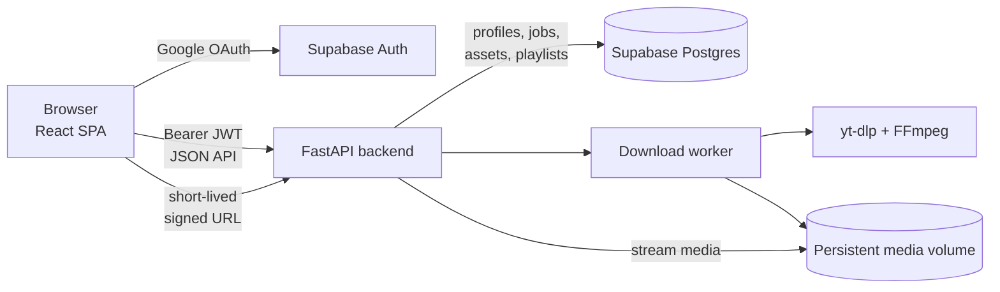

# Vidfetch

**A self-hosted web app that makes [`yt-dlp`](https://github.com/yt-dlp/yt-dlp)
usable by real people.**

Vidfetch gives you a clean browser interface for downloading videos and
playlists, with Google sign-in, administrator approval, a personal library, and
a shared cache that stops the same file being downloaded twice.

It is built for a home server, a small team, or a family. The backend does the
heavy lifting with `yt-dlp` and FFmpeg; the frontend is a standalone React app.

Vidfetch is designed to run in two ways:

- **Local development:** a two-service Docker Compose stack (frontend + backend)
- **Production:** the frontend on **Vercel**, the backend on a **VPS container**,
  and **Supabase Cloud** for auth, Postgres, and the approval workflow

> **Deployment status:** the current tagged release still ships as a single
> multi-stage image with one origin. The split `frontend/Dockerfile`,
> `backend/Dockerfile`, two-service Compose file, and Vercel configuration
> described below are the **approved next step** and are not implemented yet.
> No application code was changed for this README revision.

> ⚠️ **Use it responsibly.** Vidfetch is only a frontend for `yt-dlp`. Download
> content you are authorized to download, and follow the laws and terms of
> service that apply to you and your sources.

---

## Contents

- [Quick start](#quick-start)
- [The problem Vidfetch solves](#the-problem-vidfetch-solves)
- [What v2 adds](#what-v2-adds)
- [How it works](#how-it-works)
- [Deployment models](#deployment-models)
- [Configuration](#configuration)
- [Development](#development)
- [Project layout](#project-layout)
- [Security notes](#security-notes)
- [Troubleshooting](#troubleshooting)
- [Known limitations](#known-limitations)
- [Documentation](#documentation)

---

## Quick start

### What you need

- **Docker** and **Docker Compose** v2+
- A **Supabase** project (free tier is fine to start)
- A **Google Cloud OAuth 2.0 client**
- The **Supabase CLI** (`npx supabase`) if you want to apply migrations from
  the terminal

Everything else — Python, Node.js, `yt-dlp`, FFmpeg — is inside the containers.

### 1. Create the Supabase project and enable Google login

1. Create a project at <https://supabase.com>.
2. In **Authentication → Providers → Google**, enable Google and paste your
   Google OAuth client ID and secret.
3. In your Google Cloud OAuth client, add this authorized redirect URI:

   ```text
   https://<project-ref>.supabase.co/auth/v1/callback
   ```

4. In **Authentication → URL Configuration**, set:
   - **Site URL:** `http://localhost:8000`
   - **Redirect URLs:** `http://localhost:8000` and
     `http://localhost:5173`

### 2. Configure the app

```bash
cp .env.example .env
```

Fill in these values from **Project Settings → API** and
**Project Settings → Database**:

```dotenv
SUPABASE_URL=https://<project-ref>.supabase.co
SUPABASE_ANON_KEY=...
SUPABASE_SERVICE_ROLE_KEY=...
DATABASE_URL=postgresql://...

DB_SCHEMA=public

MEDIA_TOKEN_SECRET=<a long random secret>
VITE_SUPABASE_URL=https://<project-ref>.supabase.co
VITE_SUPABASE_ANON_KEY=...
```

Generate the media secret with:

```bash
python3 -c "import secrets; print(secrets.token_urlsafe(48))"
```

> `SUPABASE_SERVICE_ROLE_KEY`, `DATABASE_URL`, and `MEDIA_TOKEN_SECRET` are
> backend secrets. Never put them in the frontend or commit them.

### 3. Create the database tables

Link the project and push the migrations:

```bash
npx supabase login
npx supabase link --project-ref <project-ref>
npx supabase db push
```

You can also run the SQL files from `supabase/migrations/` in the Supabase SQL
editor.

> Want a dedicated schema such as `vidfetch` instead of `public`? See
> [Database schema](#database-schema).

### 4. Start Vidfetch locally

Vidfetch supports two Docker layouts. The current release uses the first; the
second is the target split deployment described in
[Deployment models](#deployment-models).

#### Option A — current release: one all-in-one image

```bash
docker compose up --build
```

Open **http://localhost:8000**.

The root `Dockerfile` builds the React app in a Node stage, copies the static
output into the Python runtime stage, and FastAPI serves both the SPA and
`/api` from the same origin. This is the simplest local setup and is what the
current tagged release uses.

#### Option B — split frontend and backend containers (target)

This is the deployment refactor. It is not implemented in the current release
yet, but the target layout is:

```text
frontend/Dockerfile   React build + nginx, proxies /api to backend:8000
backend/Dockerfile    Python + yt-dlp + FFmpeg, runs uvicorn
docker-compose.yml    frontend + backend services; Supabase stays external
```

The intended local flow is:

```bash
# after the split is implemented
docker compose up --build
# frontend: http://localhost:3000
# backend API: http://localhost:8000
```

The frontend container serves the SPA and proxies `/api` to the backend
container, keeping browser requests same-origin locally. Only the backend
receives `DATABASE_URL`, `SUPABASE_SERVICE_ROLE_KEY`, and `MEDIA_TOKEN_SECRET`.

### 5. Make yourself the first administrator

Sign in with Google. Your account will land on **`/pending`** because new
accounts are not approved automatically.

Promote yourself in the Supabase SQL editor:

```sql
update public.profiles
   set is_approved = true,
       app_role = 'admin',
       approved_at = now(),
       approved_by = id
 where lower(email) = lower('you@example.com');
```

Or use the helper script:

```bash
DATABASE_URL=... DB_SCHEMA=public \
  python3 scripts/promote_admin.py --email you@example.com
```

The script needs the `asyncpg` Python package (`pip install asyncpg`).

Refresh the app. You can now approve other users from **`/admin`**.

---

## The problem Vidfetch solves

`yt-dlp` is an excellent downloader, but it is a command-line tool. That is
perfect for one person at a terminal and awkward for everyone else.

If you want to share downloading with other people on a server, you quickly need
things `yt-dlp` does not provide:

- a friendly web interface
- accounts and access control
- a way to stop the same popular video being downloaded repeatedly
- a per-user library and download history
- safe in-browser preview and download links
- a queue that survives restarts and reports progress

Vidfetch wraps `yt-dlp` in a small, opinionated application that provides those
pieces. It is deliberately self-hosted: you own the server, the storage, the
Supabase project, and the access list.

### The idea in one sentence

> A private, self-hosted “download corner” where approved users paste a link,
> pick a format, and get a clean library — while the server downloads each
> distinct file only once.

---

## What v2 adds

The v2 rewrite turns the original single-user interface into a small multiuser
service:

- **Google sign-in through Supabase**, so there are no passwords to manage.
- **Manual administrator approval.** A new account can sign in but cannot
  download or view media until an admin approves it.
- **Admin panel** for approving, revoking, and promoting users. The backend
  enforces the result immediately, not just the buttons in the UI.
- **Supabase Postgres** for profiles, jobs, playlists, and the media registry.
- **Shared media cache.** Two users asking for the same video and format get the
  same file; the server downloads it once.
- **Durable download queue** stored in Postgres, with progress, cancellation,
  restart recovery, and per-user history.
- **Playlists and on-demand ZIPs**, including per-item status and partial
  failures.
- **Signed media URLs** for preview and download, so `<video>` and `` can
  work without exposing the database or filesystem.
- **Configurable database schema.** Great for forks; a deployment can use
  `public` (default) or a dedicated schema such as `vidfetch`.
- **A simple single-image deployment today**, with a split
  frontend/backend layout as the next deployment step.

---

## How it works



### The main pieces

| Layer | Technology | Responsibility |
| --- | --- | --- |
| **Frontend** | React, Vite, TypeScript, Tailwind CSS, Material Design 3, `supabase-js` | Login, route guards, dashboard, library, history, playlists, admin panel |
| **Backend** | FastAPI, Python, `asyncpg`, Pydantic, PyJWT | JWT verification, approval checks, job API, media streaming, admin API |
| **Download engine** | `yt-dlp` + FFmpeg | Metadata extraction, downloads, merging, MP3 conversion, subtitles |
| **Data & auth** | Supabase Auth + Postgres | Google OAuth, profiles, approval, jobs, cache registry, playlists |
| **Storage** | Docker volume | Media files, thumbnails, temporary work directories |
| **Deployment** | Docker + Compose / Vercel + VPS | Single-origin today; split deployment next |

### The download lifecycle

1. A user signs in with Google; Supabase issues a JWT.
2. Every API request carries that JWT. The backend verifies it and loads the
   user’s `profiles` row.
3. If the account is not approved, protected endpoints return `403`.
4. For a download, the backend resolves the media’s canonical identity and
   hashes the requested output options.
5. It atomically checks the shared cache:
   - **cached and valid** → reuse the file immediately;
   - **another download in progress** → wait for it;
   - **missing or failed** → claim it and enqueue one download.
6. A background worker runs `yt-dlp`/FFmpeg and updates progress in Postgres.
7. The finished file is stored under the media volume and registered as ready.
8. The browser receives a short-lived signed URL for preview or download.

The cache is the part that makes Vidfetch different from putting a download
button on top of `yt-dlp`: the second user asking for the same file costs no
bandwidth and no extra disk.

---

## Deployment models

The application code and API are the same in every mode; packaging, origins, and
environment variables differ. The split layouts below are the **target** for
the next deployment refactor and are not in the current tagged release yet.

| Mode | Frontend | Backend | Database/Auth | Status |
| --- | --- | --- | --- | --- |
| **Local all-in-one** | Built SPA served by FastAPI | Same container | Supabase Cloud | Current release |
| **Local split** | `frontend/Dockerfile` (nginx) | `backend/Dockerfile` | Supabase Cloud | Target |
| **Production** | Vercel | VPS container behind TLS | Supabase Cloud | Target |

### Current release: single-origin image

```text
Dockerfile
  stage 1: node:22-alpine  -> npm ci && npm run build
  stage 2: python:3.11-slim -> FastAPI + ffmpeg + node
                              copies frontend/dist to /app/frontend-dist

docker-compose.yml
  app:
    build: .
    ports: "8000:8000"
    env_file: .env
    volumes: ./downloads:/app/downloads
```

FastAPI serves both the SPA and `/api` on port 8000. Because everything is on
one origin, the browser needs no CORS configuration and the frontend uses
relative API paths.

### Target local split: two containers

```text
frontend/Dockerfile
  stage 1: node:22-alpine -> npm ci && npm run build
  stage 2: nginx:alpine   -> static files + SPA fallback
                             location /api/ { proxy_pass http://backend:8000; }

backend/Dockerfile
  python:3.11-slim + ffmpeg + node
  pip install -r requirements.txt
  uvicorn backend.app.main:app --host 0.0.0.0 --port 8000
  VOLUME /app/downloads

docker-compose.yml
  frontend: build ./frontend, ports "3000:80", depends_on backend
  backend:  build ./backend,  ports "8000:8000", volume ./downloads
```

Local split details:

- The frontend image contains only public `VITE_*` values.
- The backend image contains `DATABASE_URL`, `SUPABASE_SERVICE_ROLE_KEY`, and
  `MEDIA_TOKEN_SECRET`.
- Local browser requests stay same-origin because nginx proxies `/api` to the
  backend.
- Supabase Cloud remains external; auth redirect URLs include
  `http://localhost:3000`.
- The frontend does not serve media itself; signed media URLs point at the
  backend (proxied through nginx or absolute in production).

### Target production: Vercel + VPS

**Frontend on Vercel**

- Root directory: `frontend`
- Build command: `npm run build`
- Output directory: `dist`
- Environment:
  - `VITE_SUPABASE_URL`
  - `VITE_SUPABASE_ANON_KEY`
  - `VITE_API_BASE=https://api.example.com/api`
- A `vercel.json` SPA rewrite sends client-side routes such as `/library` and
  `/admin` to `index.html`.

**Backend on a VPS**

- Build `backend/Dockerfile` and run the container behind Caddy/nginx with TLS.
- Persist `/app/downloads` as a host volume or managed disk.
- Environment includes the Supabase service-role key, database URL, JWT
  verification settings, `MEDIA_TOKEN_SECRET`, and explicit
  `CORS_ORIGINS=https://app.example.com`.
- The worker runs inside the backend container; keep it on a single instance
  until shared storage and a shared queue are introduced.

**Cross-origin concerns**

- The backend must allow the Vercel origin (and `Authorization` headers) via
  `CORS_ORIGINS`; wildcard origins are not appropriate for credentialed
  production traffic.
- Supabase Auth must allow the Vercel domain and localhost redirect URLs.
- Signed media URLs must be usable from the Vercel origin. The backend can
  return absolute URLs based on a configured public API URL, or the frontend can
  prefix relative URLs with `VITE_API_BASE`. Absolute URLs are clearer for
  media, ZIPs, and `<video>` elements.
- Cookies are not used; the JSON API uses Bearer JWTs and media uses
  short-lived signed URLs.

### Which option should I use?

- **Single machine, simplest setup:** current all-in-one image.
- **Local development with production-like separation:** two-service Compose.
- **Public production deployment:** Vercel frontend + VPS backend + Supabase
  Cloud, with explicit CORS and absolute API/media URLs.

---

## Configuration

All settings live in `.env`; `.env.example` documents every variable.

### Core

| Variable | Default | Purpose |
| --- | --- | --- |
| `SUPABASE_URL` | — | Supabase project URL |
| `SUPABASE_ANON_KEY` | — | Public Supabase key |
| `SUPABASE_SERVICE_ROLE_KEY` | — | Backend-only Auth admin key |
| `DATABASE_URL` | — | Postgres connection string (pooler recommended) |
| `DB_SCHEMA` | `public` | Schema holding the application tables |
| `MEDIA_TOKEN_SECRET` | — | HMAC secret for signed media URLs |
| `MEDIA_TOKEN_TTL_SECONDS` | `900` | Signed URL lifetime |
| `DOWNLOAD_DIR` | `/app/downloads` | Media storage root |
| `FRONTEND_DIST` | `/app/frontend-dist` | Built SPA assets (single-image mode) |
| `CORS_ORIGINS` | empty | Comma-separated frontend origins for split deployment |

### Download limits

| Variable | Default | Purpose |
| --- | --- | --- |
| `MAX_CONCURRENT_DOWNLOADS` | `2` | Global worker concurrency |
| `MAX_CONCURRENT_JOBS_PER_USER` | `2` | Per-user job concurrency |
| `MAX_PLAYLIST_ITEMS` | `200` | Playlist item cap |
| `MAX_ASSET_BYTES` | `5368709120` | Per-file size cap |
| `MIN_FREE_DISK_MB` | `500` | Refuse downloads below this free space |
| `JOB_LEASE_SECONDS` | `300` | Worker/asset lease duration |
| `ALLOW_PRIVATE_URLS` | `false` | Permit private/loopback URLs (tests only) |

### Frontend

| Variable | Default | Purpose |
| --- | --- | --- |
| `VITE_SUPABASE_URL` | — | Supabase URL embedded at build time |
| `VITE_SUPABASE_ANON_KEY` | — | Public anon key embedded at build time |
| `VITE_API_BASE` | `/api` | API base path |

### Database schema

The default is `public`, so a fork works without extra steps. A deployment can
use a dedicated schema, for example `vidfetch`:

```bash
DB_SCHEMA=vidfetch python scripts/render_migrations.py \
  --output /tmp/vidfetch-migrations

DATABASE_URL=postgresql://... \
  python scripts/apply_migrations.py \
  --migrations-dir /tmp/vidfetch-migrations
```

Then set `DB_SCHEMA=vidfetch` in `.env` and restart the app. The migrations are
generated from `supabase/templates/`; `scripts/render_migrations.py --check`
verifies the committed `public` migrations are in sync.

### Persistent data

- `./downloads` → media, thumbnails, temporary work directories.
- Supabase Postgres → profiles, approval, jobs, cache registry, playlists.

Removing an item from a library only hides the user’s job. It never deletes a
shared media file that another user may still need.

---

## Development

### Backend

```bash
python3 -m venv .venv
. .venv/bin/activate
pip install -r requirements.txt -r requirements-dev.txt
uvicorn backend.app.main:app --reload --port 8000
```

### Frontend

```bash
cd frontend
npm install
npm run dev
```

The Vite dev server is expected on `http://localhost:5173`; it uses `/api` by
default, or `VITE_API_BASE` if the backend is on another origin.

### Tests and checks

```bash
# Backend unit/integration tests
python3 -m pytest backend/tests -q

# Frontend production build
cd frontend && npm run build

# Backend tests + frontend build + migration render/parse
./scripts/check_v2.sh
```

Supabase RLS and auth-trigger tests:

```bash
npx supabase start
npx supabase db reset
npx supabase test db
```

---

## Project layout

```text
backend/
  app/
    api/                 HTTP routes (auth, downloads, media, playlists, library, admin)
    core/                config, async database, JWT security, URL validation
    models/              Pydantic request/response models
    services/            yt-dlp, asset cache, jobs, worker, storage, playlists
  tests/                 v1 and v2 test suites
frontend/
  src/
    auth/                Supabase session provider and route guards
    downloads/           polling provider
    pages/               Login, Pending, Dashboard, Library, History, Playlist, Admin
    lib/                 Supabase client, API client, media-token hook
supabase/
  templates/             schema-templated migrations
  migrations/            generated public migrations
  tests/                 pgTAP RLS/auth-trigger tests
scripts/                 render/apply migrations, promote admin, local checks
docs/                    architecture, setup, implementation status
Dockerfile               current all-in-one multi-stage image
docker-compose.yml       single-origin deployment + media volume (current)

# Target split deployment (not implemented yet)
frontend/Dockerfile      React build + nginx + /api proxy
backend/Dockerfile       FastAPI + yt-dlp + FFmpeg
vercel.json              SPA rewrite for Vercel
```

---

## Security notes

- The frontend is not the security boundary. Approval and admin checks run in
  the backend on every protected request.
- JWTs are verified with Supabase’s keys; approval and role come from
  `profiles`, never from user-editable metadata.
- The service-role key and database credentials stay on the backend.
- Media URLs are short-lived and signed for one asset and one user.
- Downloads reject private/loopback URLs by default and apply size, playlist,
  and disk limits.
- Database RLS is enabled; direct client access to jobs, assets, and playlists
  is revoked.
- Shared media is never deleted by a normal user action; admin deletion and
  cache eviction own physical files.

---

## Troubleshooting

| Symptom | Check |
| --- | --- |
| Google login redirects to an error | Supabase Site/Redirect URLs and the Google OAuth redirect URI |
| Account stuck on `/pending` | `profiles.is_approved`; promote the first admin |
| `401` on API calls | Supabase URL/keys, JWT issuer/audience, server clock |
| `403 approval_required` | The account is not approved |
| `403 admin_required` | The account is approved but not an admin |
| `relation "profiles" does not exist` | Migrations not applied, or `DB_SCHEMA` differs from the schema you migrated |
| Media link returns `401` | The signed URL expired; request a fresh token |
| YouTube returns `403` | Update `yt-dlp`, wait/retry, or use a different network; YouTube rate limits and bot checks are common |
| Downloads do not start | Check the Docker logs and `/api/health` |

---

## Known limitations

- The backend is designed for **one instance with a local persistent volume**.
  Horizontal scaling would need shared storage and a shared worker deployment.
- Playlist item retry creates a new video job; there is no dedicated per-item
  retry endpoint yet.
- Playlist covers are stored but not yet served by a dedicated streaming
  endpoint.
- Playlist ZIP creation temporarily uses disk equal to the archive size; the
  archive is deleted after streaming.
- Hosted Supabase and Google OAuth must be configured with real credentials
  before production use.
- The split `frontend/Dockerfile`, `backend/Dockerfile`, two-service Compose
  file, and Vercel configuration are the target deployment refactor and are not
  part of the current tagged release yet.
- `apply_migrations.py` reapplies every file on a fresh database; it is not a
  ledger-based production migration runner.

---

## Documentation

- [`docs/ARCHITECTURE_V2.md`](docs/ARCHITECTURE_V2.md) — full design, data model,
  security model, and trade-offs
- [`docs/V2_SETUP.md`](docs/V2_SETUP.md) — detailed Supabase, Google OAuth,
  local, and Docker setup
- [`docs/IMPLEMENTATION_STATUS.md`](docs/IMPLEMENTATION_STATUS.md) — what is
  implemented and verified
- [`AGENTS.md`](AGENTS.md) — branch, versioning, and contributor rules

---

## License

Released under the [MIT License](LICENSE). Provided as-is; you are responsible
for using it lawfully.
