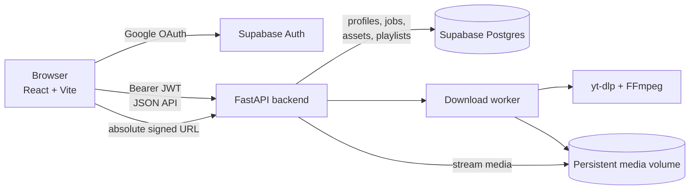

# Vidfetch

**A self-hosted web app that makes [`yt-dlp`](https://github.com/yt-dlp/yt-dlp)
usable by real people.**

Vidfetch gives you a browser interface for downloading videos and playlists,
with Google sign-in, administrator approval, a personal library, and a shared
cache that stops the same file being downloaded twice.

It is built around two deployment modes:

- **Local:** one `docker compose up` starts the Vite frontend, the FastAPI
  backend, and a complete local Supabase stack. No cloud account is required.
- **Production:** the frontend runs on **Vercel**, the backend runs as a
  container on a **VPS**, and both use **Supabase Cloud**.

> ⚠️ **Use it responsibly.** Vidfetch is only a frontend for `yt-dlp`. Download
> content you are authorized to download, and follow the laws and terms of
> service that apply to you and your sources.

### Choose your path

| Goal | Start here | What you need |
| --- | --- | --- |
| Try it locally / develop | [Quick start — local](#quick-start--local) | Docker + Compose only |
| Run it for real | [Production deployment](#production-deployment) | Supabase Cloud, Vercel, a VPS, Google OAuth |

Both modes use the same frontend, backend, database schema, migrations, and API.
Only the packaging and hosting differ.

---

## Contents

- [Quick start — local](#quick-start--local)
- [Production deployment](#production-deployment)
- [The problem Vidfetch solves](#the-problem-vidfetch-solves)
- [How it works](#how-it-works)
- [Configuration](#configuration)
- [Development](#development)
- [Project layout](#project-layout)
- [Security notes](#security-notes)
- [Troubleshooting](#troubleshooting)
- [Known limitations](#known-limitations)
- [Documentation](#documentation)

---

## Quick start — local

### What you need

- **Docker** and **Docker Compose** v2+
- That is it for the default local stack.

You do **not** need a Supabase Cloud project, the Supabase CLI installed on the
host, Python, Node.js, FFmpeg, or Google OAuth credentials to run the local app.
The local Compose stack provides:

| Service | Purpose | Address |
| --- | --- | --- |
| `frontend` | Vite dev server with hot reload | <http://localhost:5173> |
| `backend` | FastAPI + `yt-dlp` + FFmpeg + worker | <http://localhost:8000> |
| `supabase` | Official Supabase CLI local stack | API `:54321`, DB `:54322` |
| `local-bootstrap` | Creates and approves a local admin | one-shot container |
| Studio | Supabase web UI | <http://localhost:54323> |

### Start everything

From the repository root:

```bash
docker compose up --build
```

The first run builds the images and starts the Supabase stack, so it can take a
few minutes. On later runs it is much faster.

Open **<http://localhost:5173>**.

Sign in with the local development account:

```text
email:    admin@local.test
password: password123
```

The local login form is enabled only when `VITE_ENABLE_LOCAL_AUTH=true`, which
the local Compose file sets. Production builds leave it unset and use Google
OAuth only.

### Local tips

- **Supabase Studio:** <http://localhost:54323>
- **Local mail catcher:** <http://localhost:54324>
- **Backend health:** <http://localhost:8000/api/health>
- **Stop everything:** `docker compose down`
- **Rebuild after dependency changes:** `docker compose up --build`
- **Reset the local database:** while the stack is running:
  ```bash
  docker compose exec supabase supabase db reset
  ```
  Then restart the local bootstrap if needed:
  ```bash
  docker compose up local-bootstrap
  ```
- If ports `5173`, `8000`, `54321`, `54322`, or `54323` are already in use,
  stop the competing service first.
- Docker may require `sudo` on Linux depending on how it is installed.

### What the local stack is doing

The local `supabase` service runs the official Supabase CLI inside a small
container. It uses the mounted Docker socket to start the official local
Supabase containers, and host networking so the CLI’s health checks can reach
the host-published Postgres and Auth ports. The repository is mounted at the
same absolute path inside and outside the wrapper so Docker path references stay
valid.

`docker compose down` stops the wrapper, and the wrapper’s signal handler runs
`supabase stop --no-backup` to clean up the local Supabase containers.

---

## Production deployment

Production is decoupled:

```text
Vercel frontend  ──HTTPS + JWT──►  VPS backend container  ──►  Supabase Cloud
      │                                                           │
      └──────────────── Google OAuth ─────────────────────────────┘
```

### 1. Supabase Cloud

1. Create a project at <https://supabase.com>.
2. Enable **Authentication → Providers → Google** and add your Google OAuth
   client ID and secret.
3. In the Google Cloud OAuth client, authorize:
   `https://<project-ref>.supabase.co/auth/v1/callback`
4. In Supabase **Authentication → URL Configuration**, set:
   - Site URL: `https://your-app.vercel.app`
   - Redirect URLs: `https://your-app.vercel.app` and
     `http://localhost:5173`
5. Apply the migrations. Choose **one** schema per database:
   - **Default `public`**:
     ```bash
     npx supabase login
     npx supabase link --project-ref <project-ref>
     npx supabase db push
     ```
   - **Dedicated `vidfetch`**: render and apply the migrations instead of using
     `db push`. Full instructions in
     [Database schema → dedicated schema](#dedicated-schema-vidfetch).
6. In **Project Settings → API → Data API**, disable the Data API, keep
   “Grant API access to new tables automatically” **off**, and keep
   “Enable RLS on new tables automatically” **on**. Do **not** expose `vidfetch`
   in the Data API; the backend connects directly to Postgres.

For a dedicated schema such as `vidfetch`, `DB_SCHEMA=vidfetch` is the only
backend switch; the schema and tables are created by the rendered migrations.
See [Database schema](#database-schema).

### 2. Frontend on Vercel

Create a Vercel project with:

- **Root Directory:** `frontend`
- **Framework:** Vite (auto-detected; `frontend/vercel.json` is included)
- **Build command:** `npm run build`
- **Output directory:** `dist`

Set these environment variables in Vercel:

```dotenv
VITE_SUPABASE_URL=https://your-project.supabase.co
VITE_SUPABASE_ANON_KEY=your-anon-key
VITE_API_BASE=https://api.example.com/api
```

Do **not** set `VITE_ENABLE_LOCAL_AUTH` in production. Do **not** put the
service-role key or `DATABASE_URL` in Vercel.

### 3. Backend on a VPS

On the VPS, copy the repository and create `.env` from `.env.example`:

```dotenv
SUPABASE_URL=https://your-project.supabase.co
SUPABASE_ANON_KEY=your-anon-key
SUPABASE_SERVICE_ROLE_KEY=your-service-role-key
DATABASE_URL=postgresql://...
DB_SCHEMA=public

PUBLIC_API_URL=https://api.example.com
CORS_ORIGINS=https://your-app.vercel.app
MEDIA_TOKEN_SECRET=<long random secret>
```

Start the backend image:

```bash
docker compose -f docker-compose.prod.yml up -d --build
```

Put Caddy or nginx in front of port 8000 for HTTPS. The media volume is a named
Docker volume (`vidfetch_downloads`); back it up if cached media matters.

### 4. First administrator

Sign in once with Google; the account lands on `/pending`. Promote it with the
same schema the backend uses:

```bash
DATABASE_URL=... DB_SCHEMA=public \
  python3 scripts/promote_admin.py --email you@example.com

# dedicated schema
DATABASE_URL=... DB_SCHEMA=vidfetch \
  python3 scripts/promote_admin.py --email you@example.com
```

Or run the equivalent in the Supabase SQL editor:

```sql
update public.profiles ...
-- or: update vidfetch.profiles ...
```

Refresh the app and approve other users at `/admin`.

### Production checklist

- [ ] Supabase migrations applied to the hosted project.
- [ ] `DB_SCHEMA` matches the schema that received the migrations (`public` or `vidfetch`).
- [ ] Dedicated schema: rendered migrations applied, `vidfetch` not exposed in the Data API.
- [ ] Google OAuth redirect URLs configured.
- [ ] Vercel env has the Supabase URL/anon key and the backend API URL.
- [ ] VPS `.env` has backend secrets and `PUBLIC_API_URL`.
- [ ] `CORS_ORIGINS` contains the Vercel origin.
- [ ] TLS is terminated in front of the backend.
- [ ] The media volume is persistent and backed up.
- [ ] The first admin is promoted.

---

## The problem Vidfetch solves

`yt-dlp` is an excellent downloader, but it is a command-line tool. That is
perfect for one person at a terminal and awkward for everyone else.

If you want to share downloading with other people on a server, you quickly need
things `yt-dlp` does not provide:

- a friendly web interface
- accounts and access control
- a way to stop the same popular video being downloaded repeatedly
- a per-user library with tracks, curated playlists, and offline playback
- safe in-browser preview and download links
- a queue that survives restarts and reports progress

Vidfetch wraps `yt-dlp` in a small, opinionated application that provides those
pieces. It is deliberately self-hosted: you own the server, the storage, the
Supabase project, and the access list.

### The idea in one sentence

> A private, self-hosted “download corner” where approved users paste a link,
> pick a format, and get a clean library — while the server downloads each
> distinct file only once.

---

## How it works



### The main pieces

| Layer | Technology | Responsibility |
| --- | --- | --- |
| **Frontend** | React, Vite, TypeScript, Tailwind CSS, Material Design 3, `supabase-js` | Login, route guards, home, tracks, playlists, artists & albums, player, offline library, admin panel |
| **Backend** | FastAPI, Python, `asyncpg`, Pydantic, PyJWT | JWT verification, approval checks, job API, media streaming, admin API |
| **Download engine** | `yt-dlp` + FFmpeg | Metadata extraction, downloads, merging, MP3 conversion, subtitles |
| **Data & auth** | Supabase Auth + Postgres | Google OAuth, profiles, approval, jobs, cache registry, playlists |
| **Local infrastructure** | Docker Compose + Supabase CLI | Frontend, backend, and a complete local Supabase stack |
| **Production** | Vercel + VPS container | Static frontend CDN + long-running API/worker |

### The download lifecycle

1. A user signs in with Google (or the local development form); Supabase issues
   a JWT.
2. Every API request carries that JWT. The backend verifies it and loads the
   user’s `profiles` row.
3. If the account is not approved, protected endpoints return `403`.
4. For a download, the backend resolves the media’s canonical identity and
   hashes the requested output options.
5. It atomically checks the shared cache:
   - **cached and valid** → reuse the file immediately;
   - **another download in progress** → wait for it;
   - **missing or failed** → claim it and enqueue one download.
6. A background worker runs `yt-dlp`/FFmpeg and updates progress in Postgres.
7. The finished file is stored under the media volume and registered as ready.
8. The browser receives a short-lived **absolute** signed URL for preview or
   download.

The cache is what makes Vidfetch different from putting a download button on
top of `yt-dlp`: the second user asking for the same file costs no bandwidth and
no extra disk.

---

## Configuration

### Local

The local stack is configured in `docker-compose.yml` and works without a
`.env` file. It uses fixed, public, disposable local Supabase keys and starts
`admin@local.test` automatically.

### Production backend (`.env`)

| Variable | Default | Purpose |
| --- | --- | --- |
| `SUPABASE_URL` | — | Supabase project URL |
| `SUPABASE_ANON_KEY` | — | Public Supabase key |
| `SUPABASE_SERVICE_ROLE_KEY` | — | Backend-only Auth admin key |
| `DATABASE_URL` | — | Supabase Postgres connection string |
| `DB_SCHEMA` | `public` | Application table schema |
| `PUBLIC_API_URL` | — | Absolute backend origin for media/ZIP URLs |
| `CORS_ORIGINS` | — | Comma-separated frontend origins |
| `MEDIA_TOKEN_SECRET` | — | HMAC secret for signed media URLs |
| `MEDIA_TOKEN_TTL_SECONDS` | `900` | Signed URL lifetime |
| `DOWNLOAD_DIR` | `/app/downloads` | Media storage root |
| `MAX_CONCURRENT_DOWNLOADS` | `2` | Global worker concurrency |
| `MAX_CONCURRENT_JOBS_PER_USER` | `2` | Per-user job concurrency |
| `MAX_PLAYLIST_ITEMS` | `200` | Playlist item cap |
| `MAX_ASSET_BYTES` | `5368709120` | Per-file size cap |
| `MIN_FREE_DISK_MB` | `500` | Disk-space safety floor |
| `JOB_LEASE_SECONDS` | `300` | Worker/asset lease duration |
| `ALLOW_PRIVATE_URLS` | `false` | Private/loopback URLs (tests only) |

### Production frontend (Vercel)

| Variable | Purpose |
| --- | --- |
| `VITE_SUPABASE_URL` | Supabase project URL |
| `VITE_SUPABASE_ANON_KEY` | Public anon key |
| `VITE_API_BASE` | Absolute backend API URL, e.g. `https://api.example.com/api` |
| `VITE_ENABLE_LOCAL_AUTH` | Leave unset in production |

Never expose `SUPABASE_SERVICE_ROLE_KEY`, `DATABASE_URL`, or
`MEDIA_TOKEN_SECRET` to the frontend.

### Database schema

The backend reads **`DB_SCHEMA`** (default `public`), validates it, and routes
every application query to that schema. The schema is **not** created
automatically by the backend, and the committed migrations target `public`.
Apply migrations for exactly one schema per database — do not install both.

| Deployment | Migrations | Backend |
| --- | --- | --- |
| Default | `npx supabase db push` | `DB_SCHEMA=public` |
| Dedicated | render + apply `vidfetch` (below) | `DB_SCHEMA=vidfetch` |

#### Dedicated schema (`vidfetch`)

1. **Do not run `npx supabase db push`.** The committed
   `supabase/migrations/*.sql` files target `public`; running them installs the
   app in the wrong schema and attaches the auth trigger there.
2. **Render the schema-aware migrations** from the repo root:
   ```bash
   DB_SCHEMA=vidfetch python3 scripts/render_migrations.py \
     --output /tmp/vidfetch-migrations
   ```
   The first file creates the schema; the rest create the tables, RLS, and the
   `auth.users` trigger. Confirm the files contain `"vidfetch"`, not
   `{{schema}}`.
3. **Apply the rendered files in filename order.** Either:
   - paste them into the Supabase SQL Editor, or
   - use a **direct or session-pooler** connection (port `5432`), not the
     transaction pooler:
     ```bash
     DATABASE_URL='postgresql://postgres.<ref>:<password>@db.<ref>.supabase.co:5432/postgres' \
       python3 scripts/apply_migrations.py \
       --migrations-dir /tmp/vidfetch-migrations
     ```
4. **Set the backend environment**:
   ```dotenv
   DB_SCHEMA=vidfetch
   # the app can keep the transaction pooler on 6543
   DATABASE_URL=postgresql://postgres.<ref>:<password>@aws-0-<region>.pooler.supabase.com:6543/postgres
   ```
   Restart the backend and check `GET /api/health` reports `"database": true`.
5. **Verify** in the SQL Editor:
   ```sql
   select table_name
     from information_schema.tables
    where table_schema = 'vidfetch'
    order by table_name;

   select tgname
     from pg_trigger
    where tgrelid = 'auth.users'::regclass
      and not tgisinternal;
   ```
   Expect the nine app tables and `on_auth_user_created`.
6. **First admin** uses the same schema:
   ```sql
   update vidfetch.profiles
      set is_approved = true,
          app_role = 'admin',
          approved_at = now(),
          approved_by = id
    where lower(email) = lower('you@example.com');
   ```

Notes:

- `DB_SCHEMA` is the only schema switch. If it disagrees with the applied
  migrations, requests fail with `relation "profiles" does not exist`.
- Supabase Data API settings concern `public`; keep `vidfetch` unexposed. The
  backend uses `DATABASE_URL`, not PostgREST.
- The RLS/auth-trigger pgTAP test (`supabase/tests/`) is **public-only**; it is
  not a custom-schema test suite.
- If the project already has the app in `public`, start from a clean database
  (or reset it) before switching. Running both installs two table sets and the
  second migration repoints the `auth.users` trigger.

### Persistent data

- Docker volume `vidfetch_downloads` → media, thumbnails, temporary work
  directories.
- Supabase Postgres → profiles, approval, jobs, cache registry, playlists.
- Local Supabase CLI volumes → local database, Auth, Storage, and Studio data.

Removing an item from a library only hides the user’s job. It never deletes a
shared media file that another user may still need.

---

## Development

### Local full stack

```bash
docker compose up --build
# frontend: http://localhost:5173
# backend:  http://localhost:8000
```

Vite runs in the container with the source directory bind-mounted, so edits hot
reload. The backend image does not auto-reload; rebuild it after backend changes:

```bash
docker compose up -d --build backend
```

### Backend without Docker

```bash
python3 -m venv .venv
. .venv/bin/activate
pip install -r backend/requirements.txt -r backend/requirements-dev.txt
uvicorn backend.app.main:app --reload --port 8000
```

### Frontend without Docker

```bash
cd frontend
npm install
npm run dev
```

Set `VITE_API_BASE` and `VITE_SUPABASE_URL` in `frontend/.env.local` when
running outside the local Compose stack.

### Tests and checks

```bash
# Backend
python3 -m pytest backend/tests -q

# Frontend
cd frontend && npm run build

# Backend + frontend + migration render/parse
./scripts/check_v2.sh
```

Supabase RLS/auth-trigger tests:

```bash
npx supabase start
npx supabase db reset
npx supabase test db
```

### Docker images

```bash
docker build -t vidfetch-backend ./backend
docker build -t vidfetch-frontend ./frontend   # local Vite image
docker compose config                           # validate local stack
```

The frontend image is intentionally a development/Vite image. Vercel builds the
production frontend.

---

## Project layout

```text
backend/
  Dockerfile             standalone FastAPI + yt-dlp + FFmpeg image
  requirements.txt       backend runtime dependencies
  app/
    api/                 HTTP routes (auth, downloads, media, playlists, library, admin)
    core/                config, async database, JWT security, URL validation
    models/              Pydantic request/response models
    services/            yt-dlp, asset cache, jobs, worker, storage, playlists
  tests/                 test suite

frontend/
  Dockerfile             local Vite dev-server image
  vercel.json            Vercel/Vite + SPA rewrite
  src/
    auth/                Supabase session provider and route guards
    downloads/           polling provider
    pages/               Login, Pending, Dashboard, Tracks, Playlists, Artists/Albums, Admin
    lib/                 Supabase client, API client, media-token hook

supabase/
  config.toml            local Supabase CLI configuration
  templates/             schema-templated migrations
  migrations/            generated public migrations
  tests/                 pgTAP RLS/auth-trigger tests

docker/
  supabase/              CLI wrapper used by local Compose
  local-bootstrap/       local admin bootstrap

docker-compose.yml       local frontend + backend + Supabase
docker-compose.prod.yml  VPS backend-only production stack
scripts/                 migrations, admin promotion, local checks
docs/                    architecture, setup, implementation status
```

---

## Security notes

- The frontend is not the security boundary. Approval and admin checks run in
  the backend on every protected request.
- JWTs are verified with Supabase’s keys (JWKS/HS256); approval and role come
  from `profiles`, never from user-editable metadata.
- The service-role key and database credentials stay on the backend.
- Media URLs are short-lived and signed for one asset and one user.
- Downloads reject private/loopback URLs by default and apply size, playlist,
  and disk limits.
- Database RLS is enabled; direct client access to jobs, assets, and playlists
  is revoked.
- Shared media is never deleted by a normal user action; admin deletion and
  cache eviction own physical files.
- The local bootstrap admin and fixed local Supabase keys are development-only.

---

## Troubleshooting

| Symptom | Check |
| --- | --- |
| Local stack is slow to start | First run pulls Supabase and app images; wait for the `supabase` health check |
| `local-bootstrap` exits with an error | `docker compose logs local-bootstrap`; Auth may still be starting |
| Login form does not appear locally | `VITE_ENABLE_LOCAL_AUTH=true` in the frontend container env |
| Google login redirects to an error | Supabase Site/Redirect URLs and the Google OAuth redirect URI |
| Account stuck on `/pending` | `profiles.is_approved`; promote the first admin |
| `401` on API calls | Supabase URL/keys, JWKS/issuer/audience, server clock |
| `403 approval_required` | The account is not approved |
| `403 admin_required` | The account is approved but not an admin |
| `CORS` errors in production | `CORS_ORIGINS` must equal the Vercel origin |
| Media URL fails from Vercel | `PUBLIC_API_URL` must be the public HTTPS backend origin |
| `relation "profiles" does not exist` | Migrations not applied, or `DB_SCHEMA` differs from the migrated schema |
| Local Supabase containers remain after `down` | The wrapper trap should stop them; if not, run `npx supabase stop --no-backup` |
| Ports already in use | Stop the old app/Supabase stack before `docker compose up` |

---

## Known limitations

- The backend is designed for **one instance with a persistent volume**.
  Horizontal scaling would need shared storage and a shared worker deployment.
- Playlist item retry creates a new video job; there is no dedicated per-item
  retry endpoint yet.
- Playlist covers are stored but not yet served by a dedicated streaming
  endpoint.
- Playlist ZIP creation temporarily uses disk equal to the archive size; the
  archive is deleted after streaming.
- Hosted Supabase and Google OAuth must be configured with real credentials
  before production use.
- `apply_migrations.py` reapplies every file on a fresh database; it is not a
  ledger-based production migration runner.
- The local Supabase wrapper relies on the Docker socket and host networking;
  it is intended for Linux/WSL2 development. On Docker Desktop platforms where
  host networking is restricted, use the Supabase CLI on the host instead.

---

## Documentation

- [`docs/ARCHITECTURE_V2.md`](docs/ARCHITECTURE_V2.md) — design, data model,
  security model, and trade-offs
- [`docs/V2_SETUP.md`](docs/V2_SETUP.md) — detailed Supabase, Google OAuth,
  local, and Docker setup
- [`docs/IMPLEMENTATION_STATUS.md`](docs/IMPLEMENTATION_STATUS.md) — what is
  implemented and verified
- [`AGENTS.md`](AGENTS.md) — branch, versioning, and contributor rules

---

## License

Released under the [MIT License](LICENSE). Provided as-is; you are responsible
for using it lawfully.
