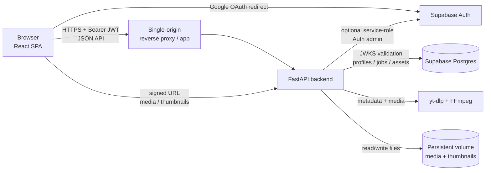

# Vidfetch v2 — Architecture Specification

| Field | Value |
| --- | --- |
| **Status** | **Approved for implementation** |
| **Document version** | 0.2 |
| **Baseline** | `v1.9.0` |
| **Target release** | `v2.0.0` |
| **Last updated** | 2026-11-21 |
| **Owner** | Orchestrator |
| **Implementation gate** | Approved 2026-11-21; implementation proceeds on the `v2` branch |

> This document describes the **target** architecture. It does not claim that any
> of it exists yet. The current `README.md` remains the accurate v1.9 operator
> documentation until v2 ships.

---

## 1. Summary

Vidfetch v2 turns the current single-user, SQLite-backed downloader into a
small multiuser application:

- **React + Vite + TypeScript** frontend.
- **FastAPI + `yt-dlp` + FFmpeg** backend.
- **Supabase Auth** with Google OAuth.
- **Manual admin approval** before a user may download anything.
- **Admin panel** for approving, revoking, and managing users.
- A **global media deduplication cache** backed by Supabase Postgres, with
  per-user download jobs and library entries.
- Persistent local media storage on a Docker volume.
- Preserved v1 product features: playlists, per-item retry, on-demand ZIP,
  subtitles, MP3 album/cover tagging, progress, cancellation, library preview,
  history, and disk-space protection.

### 1.1 Goals

1. Authenticate users with Google through Supabase.
2. Block all download and media access until an admin approves the account.
3. Never download the same `(canonical media, output options)` pair twice while
   a valid cached file exists.
4. Keep each user’s dashboard, library, history, and playlists private.
5. Preserve the v1.9 feature set or explicitly document any regression.
6. Keep the deployment simple: one application origin, one persistent volume,
   hosted Supabase for Auth/Postgres.

### 1.2 Non-goals for v2.0.0

- Self-hosting the full Supabase stack.
- Horizontal scaling of the backend.
- Public self-service signup without approval.
- A billing/subscription system.
- Replacing `yt-dlp` with a custom extraction engine.
- Multi-tenant organizations or per-user isolated storage quotas beyond a
  simple global/per-user limit.
- Cross-device synchronization beyond what Supabase already provides.

### 1.3 Key architectural decisions at a glance

| Area | Proposed decision |
| --- | --- |
| Production branch | `main` only; no separate `prod` branch |
| v2 integration | Long-lived `v2` branch + `v2-backend` / `v2-frontend` worktrees |
| Deployment | Single origin: SPA and API served behind one reverse proxy/container |
| Auth | Supabase Google OAuth; backend verifies JWT via JWKS |
| Authorization | `profiles.is_approved` + `profiles.app_role`, checked by the backend |
| Database | Supabase Postgres; async access through the Supabase pooler |
| Media cache | Global `media_assets` keyed by `canonical_id + options_hash` |
| User ownership | Per-user `download_jobs`, playlists, and playlist items |
| Queue | Durable `download_jobs` table claimed with `FOR UPDATE SKIP LOCKED` |
| Progress | Polling for MVP; optional SSE with signed stream tokens later |
| Media transport | Short-lived signed media URLs; Bearer JWT for JSON API |
| Storage | Local persistent Docker volume; LRU eviction and reconciliation |
| Playlists | Preserved, with per-item assets and on-demand ZIP |
| v1 data | Explicit migration decision required (Section 17) |

---

## 2. Current state vs target

| Concern | v1.9 (current) | v2 target |
| --- | --- | --- |
| Users | None; single implicit user | Google OAuth via Supabase; approved accounts only |
| Authorization | None | `profiles.is_approved`, `profiles.app_role` |
| Persistence | SQLite (`data/yt-dlp.db`) | Supabase Postgres |
| Media metadata | SQLite task/playlist rows | `media_assets`, `download_jobs`, `playlists`, `playlist_items` |
| Deduplication | None | `(canonical_id, options_hash)` unique cache |
| Queue | In-process asyncio task manager | Durable DB-backed job queue + worker loop |
| Progress | In-memory + SSE | DB-backed job state + polling (SSE optional) |
| Media auth | None | Signed short-lived media URLs |
| Deployment | Single Docker image, same origin | Single origin, hosted Supabase, persistent volume |
| Frontend routes | Dashboard, Library, Playlist, History, Settings | Adds Login, Pending, Admin; guards on all existing routes |
| Version source | `backend/version.py:APP_VERSION` | Unchanged; bumped only on `main` release commits |

---

## 3. System context



### 3.1 Trust boundaries

- **Browser:** untrusted. It may hold a Supabase session and signed media URLs,
  but it never holds the service-role key or database credentials.
- **Backend:** trusted application server. It holds the database URL, JWT
  verification configuration, media-signing secret, and optionally the
  Supabase service-role key for Auth admin operations.
- **Supabase Postgres/Auth:** managed external service. RLS is enabled as
  defense in depth, even though normal application access flows through the
  backend.
- **Media volume:** trusted local storage. Paths are validated and resolved
  under a single configured root.
- **yt-dlp/FFmpeg:** untrusted input processors. They receive validated URLs and
  constrained output paths; their failures are mapped to user-safe errors.

---

## 4. Component responsibilities

### 4.1 Frontend (`frontend/`)

- Create and refresh the Supabase session (`supabase-js`, PKCE).
- Render Google login and the “awaiting approval” state.
- Guard routes by authentication, approval, and admin role.
- Attach the current Supabase access token to JSON API requests.
- Request short-lived signed media URLs before rendering `<video>`, `<audio>`,
  images, or download links.
- Submit download jobs, poll active job progress, cancel jobs, retry failed
  items.
- Render the per-user dashboard, library, playlist detail, history, and preview.
- Render the admin user-management panel.
- Never query privileged tables directly; all application data goes through the
  FastAPI API.

### 4.2 Backend (`backend/`)

- Verify Supabase JWTs and load the caller’s profile.
- Enforce approval and admin authorization on every protected endpoint.
- Resolve and canonicalise media metadata.
- Compute the output-options hash.
- Claim or reuse `media_assets` atomically.
- Create and run per-user `download_jobs`.
- Run `yt-dlp` and FFmpeg in worker threads with bounded concurrency.
- Stream media with range support and short-lived signed URLs.
- Generate playlist ZIPs on demand.
- Enforce quotas, rate limits, disk-space guards, and input validation.
- Reconcile stale jobs/assets on startup.
- Emit structured, redacted logs and health information.

### 4.3 Supabase (`supabase/`)

- `auth.users`: Google-authenticated identities.
- `profiles`: application identity, approval state, and app role.
- `media_assets`: global deduplication registry and file metadata.
- `download_jobs`: durable per-user queue and job history.
- `playlists`, `playlist_items`: per-user playlist state.
- `admin_audit_log`: approval/revocation/role-change audit trail.
- SQL migrations and RLS policies under version control.
- `seed.sql` contains no production secrets and no hardcoded admin UUID.

### 4.4 Storage and deployment

- One persistent volume for media, thumbnails, and temporary work directories.
- One application origin for SPA + API (current deployment model).
- Hosted Supabase project for production; Supabase CLI for local development
  and tests.

---

## 5. Deployment topology

### 5.1 Proposed: single origin

Keep the current model: one application container (or a small nginx reverse
proxy in front of FastAPI) serves the built SPA and the API on the same origin.

Benefits:

- No CORS configuration for the normal app.
- Cookies, if used later, work without `SameSite=None` complexity.
- SSE and media URLs share an origin.
- One `docker-compose` service to operate.
- Existing Docker volume layout can be preserved.

### 5.2 Rejected for v2.0.0: split frontend/backend origins

Separate frontend and backend services are useful for independent scaling, but
they add CORS, credential, SSE, and media-auth complexity that v2 does not need.
They can be introduced later without changing the data model.

### 5.3 Docker layout

Proposed repository layout:

```text
Dockerfile                 multi-stage frontend build + backend runtime
docker-compose.yml         app service + persistent media volume
docker-entrypoint.sh       permission fix + runtime checks
```

If a reverse proxy is introduced, it should be part of the same image or a
small nginx service that proxies `/api` to FastAPI and serves the SPA. The
frontend must not be given database or service-role credentials.

---

## 6. Authentication and authorization

### 6.1 Sign-in flow

1. User opens `/login`.
2. Frontend calls Supabase Auth `signInWithOAuth({ provider: "google" })`.
3. Google redirects back to the frontend callback URL configured in Supabase.
4. `supabase-js` completes the PKCE exchange and stores the session.
5. A database trigger creates a `profiles` row on first `auth.users` insert:
   - `is_approved = false`
   - `app_role = 'user'`
   - `email` copied from the auth record
6. The frontend calls `GET /api/me`.
7. Routing:
   - No session → `/login`
   - Session, not approved → `/pending`
   - Approved → `/dashboard`
   - Approved + `app_role = 'admin'` → `/admin` is available

### 6.2 JWT verification

The backend verifies every protected request:

- Signature via Supabase JWKS:
  `${SUPABASE_URL}/auth/v1/.well-known/jwks.json`
- Issuer: `${SUPABASE_URL}/auth/v1`
- Audience: `authenticated`
- Expiry and not-before claims.
- `sub` is the Supabase user UUID.

Use a cached JWKS client (for example `PyJWT` + `PyJWKClient`), with a fallback
to the legacy shared secret only if the Supabase project has not moved to
asymmetric signing keys. Never trust `user_metadata` for approval or role.

### 6.3 Application authorization

After JWT validation, the backend loads the caller’s `profiles` row:

- `is_approved` must be `true` for every endpoint except `/api/me` and
  `/api/health`.
- `app_role` must be `admin` for `/api/admin/*`.
- The JWT `role` claim is **not** the application role. Supabase commonly emits
  `role = "authenticated"`; app roles live only in `profiles.app_role`.

Authorization may be cached per request only. If a short-lived cache is added
later, it must be at most 30 seconds so revocation is effectively immediate.

### 6.4 Endpoint access matrix

| Endpoint group | Anonymous | Authenticated, pending | Approved user | Admin |
| --- | --- | --- | --- | --- |
| `GET /api/health` | ✅ | ✅ | ✅ | ✅ |
| `GET /api/me` | ❌ 401 | ✅ | ✅ | ✅ |
| `POST /api/info` | ❌ 401 | ❌ 403 `approval_required` | ✅ | ✅ |
| `POST /api/downloads` | ❌ 401 | ❌ 403 | ✅ | ✅ |
| `GET /api/downloads/*` | ❌ 401 | ❌ 403 | ✅ own jobs | ✅ all jobs |
| `GET /api/library/*` | ❌ 401 | ❌ 403 | ✅ own library | ✅ all |
| `GET /api/media/*` | ❌ 401 | ❌ 403 | ✅ valid signed URL | ✅ |
| `GET /api/playlists/*` | ❌ 401 | ❌ 403 | ✅ own playlists | ✅ all |
| `/api/admin/*` | ❌ 401 | ❌ 403 | ❌ 403 `admin_required` | ✅ |

### 6.5 First admin bootstrap

A fresh deployment has no approved users. Bootstrap must be explicit:

1. The first user signs in with Google; a pending profile is created.
2. An operator runs a documented one-time SQL statement or CLI command:
   - `DATABASE_URL=... python3 scripts/promote_admin.py --email <email>`
   - or the equivalent `UPDATE profiles ...` in the Supabase SQL editor.
3. The command sets `is_approved = true`, `app_role = 'admin'`, and records
   `approved_at`/`approved_by` where applicable.

Do **not** commit a real admin UUID or email into `seed.sql`. Local development
may seed a known test admin through the Supabase CLI, but that must never be
part of a production migration.

### 6.6 Revocation

- Admin sets `is_approved = false` or removes `admin`.
- The backend’s per-request profile check blocks new API calls immediately.
- Existing short-lived media URLs expire within `MEDIA_TOKEN_TTL`.
- Existing Supabase sessions remain valid cryptographically, but the backend
  refuses them. Optionally, the backend can call Supabase Auth admin sign-out
  endpoints for stronger session invalidation.

### 6.7 Media and SSE authentication

A Bearer token cannot be attached to:

- `EventSource`
- `<video>`, `<audio>`, or `` elements
- plain download links

Therefore v2 uses:

- **JSON API:** `Authorization: Bearer <supabase-access-token>`.
- **Media and thumbnails:** short-lived signed URLs issued by the backend.
  The token is HMAC-signed over `(asset_id, user_id, expiry)` and verified by
  the media endpoint. It is reusable for range requests until it expires.
- **SSE (if enabled):** the same short-lived signed token in the query string,
  or a fetch-based streaming client. For the v2 MVP, polling is preferred.

Signed URL requirements:

- TTL: 5–15 minutes (`MEDIA_TOKEN_TTL`).
- Bound to user and asset.
- Never logged.
- Responses set `Cache-Control: private` and an appropriate
  `Content-Disposition`.
- Range requests are supported.

### 6.8 RLS posture

RLS is enabled as defense in depth:

- `profiles`: authenticated users may `SELECT` only their own row. Clients
  cannot `INSERT`, `UPDATE`, or `DELETE`; the trigger and backend manage writes.
- `media_assets`: no direct client access.
- `download_jobs`: no direct client access.
- `playlists` / `playlist_items`: no direct client access; all access is through
  the backend.
- `admin_audit_log`: no client access.

The backend may connect with a privileged database role. If so, authorization
must be enforced in the backend; RLS protects against accidental direct client
access and future integrations. A dedicated least-privilege database role is a
future improvement.

---

## 7. Data model

All tables live in the `public` schema unless noted. Timestamps are
`timestamptz`. UUIDs use `gen_random_uuid()`.

### 7.1 `profiles`

| Column | Type | Notes |
| --- | --- | --- |
| `id` | `uuid` PK | References `auth.users(id)` on delete cascade |
| `email` | `text` | Not null; updated on auth email change |
| `is_approved` | `boolean` | Not null, default `false` |
| `app_role` | `text` | Not null, default `'user'`; check `('user','admin')` |
| `approved_at` | `timestamptz` | Nullable |
| `approved_by` | `uuid` | Nullable; references `profiles(id)` |
| `created_at` | `timestamptz` | Not null, default `now()` |
| `updated_at` | `timestamptz` | Not null, default `now()` |

Indexes: `(is_approved)`, `(app_role)`, `(email)`.

Trigger:

- On `auth.users` insert, create a profile.
- On `auth.users` email update, synchronize `profiles.email`.
- Function is `security definer` with `set search_path = public, pg_temp`.
- Trigger is idempotent (`on conflict do nothing` / update).

### 7.2 `media_assets`

Global deduplication registry. One row per `(canonical_id, options_hash)`.

| Column | Type | Notes |
| --- | --- | --- |
| `id` | `uuid` PK | |
| `canonical_id` | `text` | e.g. `youtube:dQw4w9WgXcQ` |
| `extractor_key` | `text` | Normalized extractor key, e.g. `youtube` |
| `source_url` | `text` | Last known source URL |
| `title` | `text` | |
| `duration_seconds` | `integer` | Nullable |
| `options_hash` | `text` | SHA-256 over canonical options JSON |
| `options_schema_version` | `integer` | Starts at 1; allows future key changes |
| `format_selector` | `text` | Human-readable requested format |
| `output_ext` | `text` | Final container/extension |
| `file_path` | `text` | Relative to storage root |
| `file_size_bytes` | `bigint` | |
| `file_sha256` | `text` | Optional but recommended |
| `status` | `text` | `processing`, `ready`, `failed` |
| `error` | `text` | Safe, redacted message |
| `attempts` | `integer` | Not null, default 0 |
| `claimed_at` | `timestamptz` | Lease start |
| `lease_until` | `timestamptz` | Lease expiry |
| `created_at` | `timestamptz` | |
| `updated_at` | `timestamptz` | |
| `last_accessed_at` | `timestamptz` | Updated on media access, throttled |

Constraints and indexes:

- `UNIQUE (canonical_id, options_hash)`.
- Index on `(status, lease_until)` for reconciliation.
- Index on `(last_accessed_at)` for eviction.
- `CHECK (file_path IS NULL OR file_path NOT LIKE '/%')` to discourage absolute
  paths; the application still resolves and validates every path.

### 7.3 `download_jobs`

Per-user work queue and history. This is **not** the global asset cache.

| Column | Type | Notes |
| --- | --- | --- |
| `id` | `uuid` PK | |
| `user_id` | `uuid` | References `profiles(id)` on delete cascade |
| `asset_id` | `uuid` | Nullable until resolved; references `media_assets(id)` |
| `playlist_id` | `uuid` | Nullable; references `playlists(id)` |
| `kind` | `text` | `video`, `playlist`, `playlist_item` |
| `source_url` | `text` | Redacted in logs; stored for retry |
| `title` | `text` | |
| `options_hash` | `text` | Same hash as the asset |
| `format_selector` | `text` | |
| `idempotency_key` | `text` | Nullable; client-supplied per submission |
| `status` | `text` | `queued`, `resolving`, `downloading`, `processing`, `ready`, `failed`, `cancelled` |
| `progress` | `numeric` | 0–100 |
| `downloaded_bytes` | `bigint` | |
| `total_bytes` | `bigint` | |
| `speed` | `numeric` | Bytes per second |
| `eta_seconds` | `integer` | |
| `error` | `text` | Safe, redacted |
| `attempts` | `integer` | |
| `created_at` | `timestamptz` | |
| `updated_at` | `timestamptz` | |
| `started_at` | `timestamptz` | |
| `completed_at` | `timestamptz` | |

Constraints and indexes:

- `UNIQUE (user_id, idempotency_key)` where `idempotency_key is not null`.
- Index on `(user_id, created_at desc)` for history.
- Index on `(status, created_at)` for the worker.
- Index on `(asset_id)`.

### 7.4 `playlists`

| Column | Type | Notes |
| --- | --- | --- |
| `id` | `uuid` PK | |
| `user_id` | `uuid` | References `profiles(id)` on delete cascade |
| `canonical_id` | `text` | e.g. `youtube:PL...` |
| `source_url` | `text` | |
| `title` | `text` | |
| `channel` | `text` | |
| `thumbnail_path` | `text` | Relative to storage root |
| `item_count` | `integer` | |
| `options_hash` | `text` | Playlist-level output options |
| `format_selector` | `text` | |
| `status` | `text` | `pending`, `downloading`, `ready`, `partial`, `failed`, `cancelled` |
| `created_at` | `timestamptz` | |
| `updated_at` | `timestamptz` | |

Constraint: `UNIQUE (user_id, canonical_id, options_hash)`.

### 7.5 `playlist_items`

| Column | Type | Notes |
| --- | --- | --- |
| `id` | `uuid` PK | |
| `playlist_id` | `uuid` | References `playlists(id)` on delete cascade |
| `position` | `integer` | Position in the source playlist |
| `canonical_id` | `text` | Video canonical id |
| `source_url` | `text` | |
| `title` | `text` | |
| `duration_seconds` | `integer` | Nullable |
| `asset_id` | `uuid` | Nullable; references `media_assets(id)` |
| `job_id` | `uuid` | Nullable; references `download_jobs(id)` |
| `status` | `text` | `pending`, `downloading`, `ready`, `failed`, `cancelled` |
| `error` | `text` | |
| `created_at` | `timestamptz` | |
| `updated_at` | `timestamptz` | |

Constraints: `UNIQUE (playlist_id, position)` and
`UNIQUE (playlist_id, canonical_id)`.

### 7.6 `admin_audit_log`

| Column | Type | Notes |
| --- | --- | --- |
| `id` | `uuid` PK | |
| `actor_id` | `uuid` | References `profiles(id)` |
| `action` | `text` | `approve_user`, `revoke_user`, `promote_admin`, `demote_admin`, `delete_asset` |
| `target_user_id` | `uuid` | Nullable |
| `metadata` | `jsonb` | Non-sensitive details |
| `created_at` | `timestamptz` | |

### 7.7 Status lifecycles

Asset:

```text
(absent) -> processing -> ready
                     \-> failed -> processing (retry)
ready -> failed (file missing/corrupt) -> processing (repair)
```

Job:

```text
queued -> resolving -> downloading -> processing -> ready
                                           \-> failed
        \-> cancelled at any non-terminal point
```

Rules:

- A job may reuse a `ready` asset and go straight to `ready`.
- A job may wait on a `processing` asset; it does not start a second download.
- A `failed` asset is retried only after a new claim.
- `cancelled` jobs do not delete shared media.

---

## 8. Deduplication and download pipeline

### 8.1 Canonical identity

1. Validate the URL (scheme, host, SSRF checks).
2. Run `yt-dlp` metadata extraction with `download=False` and
   `extract_flat="in_playlist"`.
3. Derive:
   - `extractor_key` from `info["extractor_key"]` (normalized to lowercase)
   - media id from `info["id"]`
   - `canonical_id = f"{extractor_key}:{media_id}"`
4. Do not rely on manually stripping tracking query parameters. Metadata
   extraction resolves the identity. For generic extractors, normalize the URL
   into a stable canonical form and document the extractor.

### 8.2 Output options hash

`options_hash = SHA-256(canonical_json(options))`, with
`options_schema_version = 1` stored alongside it. The canonical options include:

- requested format selector / quality profile
- output container
- audio codec and bitrate
- subtitle languages and embedding behavior
- metadata embedding and thumbnail embedding
- MP3 album/cover behavior
- relevant yt-dlp postprocessor options
- cookie/account scope, or an explicit `public` scope

Hash **user intent**, not the resolved format. This keeps cache keys stable when
a site changes available formats. The trade-off is that two different selectors
that happen to resolve to the same file may produce two assets; this is
acceptable for v2 and can be optimized later with an alias table.

### 8.3 Claim algorithm

```text
BEGIN
  SELECT * FROM media_assets
   WHERE canonical_id = :canonical_id
     AND options_hash = :options_hash
   FOR UPDATE;

  IF no row:
      INSERT processing asset with lease_until = now() + lease
      claim = true
  ELSE IF status = 'ready':
      IF file exists and size/hash valid:
          UPDATE last_accessed_at (throttled)
          claim = false, cache_hit = true
      ELSE:
          UPDATE status = 'processing', new lease
          claim = true
  ELSE IF status = 'processing' AND lease_until > now():
      claim = false, cache_hit = false (wait)
  ELSE:
      UPDATE status = 'processing', attempts += 1, new lease
      claim = true
COMMIT
```

The claim and the job creation should be in the same transaction where
practical. If the asset is already `ready`, the job can be created directly in
`ready` state with the asset reference.

### 8.4 Worker loop

- A bounded worker loop claims queued jobs with
  `FOR UPDATE SKIP LOCKED LIMIT 1`.
- `MAX_CONCURRENT_DOWNLOADS` controls active downloads across the process.
- `yt-dlp` runs in a worker thread (`asyncio.to_thread`) or process pool;
  FFmpeg runs as a child process.
- The worker renews the asset lease every `JOB_LEASE_RENEW_SECONDS`.
- Progress is kept in memory for active jobs and persisted at most once per
  second (or every 5%) to avoid database churn.
- On success:
  1. Move the finished file into the final storage path atomically.
  2. Compute size and optional hash.
  3. Mark asset `ready`.
  4. Mark job `ready`.
- On failure:
  1. Mark asset `failed` with a redacted message.
  2. Mark job `failed`.
  3. Clean the temporary work directory.
- On cancellation:
  1. Mark job `cancelled`.
  2. If no other job is waiting on the asset, abort the download and mark the
     asset `failed` (or return it to a retryable state).
  3. Clean temporary files.

### 8.5 Startup reconciliation

- Jobs stuck in `resolving`/`downloading`/`processing` beyond their lease are
  marked `queued` or `failed` according to attempts.
- Assets stuck in `processing` beyond `lease_until` are marked `failed`.
- `ready` assets whose file is missing are marked `failed`.
- Orphan files in the storage root without a matching asset are logged and may
  be moved to a quarantine directory, not silently deleted.

### 8.6 Playlist pipeline

1. Resolve playlist metadata (flat extraction).
2. Upsert `playlists` and `playlist_items`, pruning positions no longer present
   in the source playlist (tracking rows only; media files are retained).
3. For each item, resolve its `canonical_id` and `options_hash`.
4. Reuse a `ready` item asset when available; otherwise create a job.
5. Per-item failures do not abort the whole playlist; the playlist becomes
   `partial`.
6. A playlist ZIP is generated on demand by streaming ready item files. No
   archive is persisted.
7. Retrying a failed item creates a new job for that item.

### 8.7 Delete semantics

- **User “remove from library”** deletes or archives the user’s `download_jobs`
  row (and playlist item reference). It never deletes a shared `media_assets`
  file.
- **Playlist delete** removes the user’s playlist and item rows. Shared media
  remains.
- **Admin asset deletion** removes a global asset and its file only after
  checking that no active job or stream is using it.
- **Eviction** is the normal way shared files disappear (Section 12).

### 8.8 Idempotency

Clients may send `Idempotency-Key` with `POST /api/downloads`. The backend
stores it on the job and returns the existing job for a repeated key. This
prevents duplicate jobs from double-clicks or network retries.

---

## 9. API specification

### 9.1 Conventions

- Base path: `/api`.
- JSON request/response bodies.
- Authentication: `Authorization: Bearer <supabase-access-token>`.
- Errors use a consistent envelope:

```json
{
  "error": {
    "code": "approval_required",
    "message": "Your account is awaiting administrator approval."
  }
}
```

- Status codes:
  - `400` invalid input
  - `401` missing/invalid token
  - `403` `approval_required` or `admin_required`
  - `404` not found or not owned by the caller
  - `409` conflict/idempotency mismatch
  - `429` rate/quota exceeded
  - `500` unexpected server error
- `404` rather than `403` for resources the caller does not own, to avoid
  leaking existence.

### 9.2 Public and identity endpoints

| Method | Path | Purpose |
| --- | --- | --- |
| `GET` | `/api/health` | Liveness/readiness, version, dependency status |
| `GET` | `/api/me` | Current profile: email, approval, app role |

### 9.3 Download and media endpoints (approved users)

| Method | Path | Purpose |
| --- | --- | --- |
| `POST` | `/api/info` | Resolve video/playlist metadata before download |
| `POST` | `/api/downloads` | Create a download job (idempotent) |
| `GET` | `/api/downloads` | List the caller’s jobs, paginated/filterable |
| `GET` | `/api/downloads/{job_id}` | Job detail and progress |
| `POST` | `/api/downloads/{job_id}/cancel` | Request cancellation |
| `GET` | `/api/downloads/{job_id}/events` | Optional SSE stream |
| `GET` | `/api/library` | Caller’s ready assets, paginated |
| `DELETE` | `/api/library/{job_id}` | Remove from the caller’s library |
| `GET` | `/api/playlists` | Caller’s playlists |
| `GET` | `/api/playlists/{playlist_id}` | Playlist detail + items |
| `GET` | `/api/playlists/{playlist_id}/zip` | On-demand ZIP stream |
| `DELETE` | `/api/playlists/{playlist_id}` | Remove the caller’s playlist |
| `POST` | `/api/media/{asset_id}/token` | Issue a short-lived signed URL |
| `GET` | `/api/media/{asset_id}` | Stream media with a signed token |
| `GET` | `/api/thumbnails/{asset_id}` | Stream thumbnail with a signed token |

For v2 MVP, progress is polled via `GET /api/downloads/{job_id}` every 1–2
seconds while a job is active. SSE is optional and must use a signed token or a
fetch-based stream.

### 9.4 Admin endpoints

| Method | Path | Purpose |
| --- | --- | --- |
| `GET` | `/api/admin/users` | Paginated user list with search/filter |
| `POST` | `/api/admin/users/{user_id}/approve` | Approve a user |
| `POST` | `/api/admin/users/{user_id}/revoke` | Revoke approval |
| `POST` | `/api/admin/users/{user_id}/role` | Promote/demote admin |
| `GET` | `/api/admin/jobs` | All jobs, paginated/filterable |
| `GET` | `/api/admin/assets` | Cache inventory and disk usage |
| `DELETE` | `/api/admin/assets/{asset_id}` | Delete an asset and file |

Admin mutations are audited in `admin_audit_log`.

### 9.5 Input validation

- `url`: `http`/`https`, public host, no credentials in URL.
- `format`: constrained enum or validated selector profile.
- `embed_subs`: boolean.
- `playlist_id`: UUID owned by the caller.
- Playlist size/duration limits enforced before download.
- Filenames and titles sanitized for display and storage paths.

---

## 10. Frontend architecture

### 10.1 Routes

| Route | Access | Purpose |
| --- | --- | --- |
| `/login` | Anonymous | Google sign-in |
| `/pending` | Authenticated, not approved | Awaiting approval |
| `/dashboard` | Approved | URL submission and active jobs |
| `/library` | Approved | Ready media |
| `/playlists/:id` | Approved, owner | Playlist detail and ZIP |
| `/history` | Approved | Job history |
| `/settings` | Approved | Account and app info |
| `/admin` | Admin | Admin overview |
| `/admin/users` | Admin | User approval/role management |

### 10.2 Guards

- `RequireAuth`: redirects to `/login` when there is no session.
- `RequireApproved`: redirects pending users to `/pending`.
- `RequireAdmin`: renders a not-authorized state for non-admins.
- Guards are UX only; the backend is the security boundary.

### 10.3 API client

- Reads the current Supabase session before each request.
- Sends `Authorization: Bearer <access_token>`.
- On `401`, refreshes the session once and retries.
- On `403` with `approval_required`, refreshes `/api/me` and routes to
  `/pending`.
- On `403` with `admin_required`, shows a not-authorized state.
- Never stores database/service credentials.

### 10.4 Media rendering

1. Request a signed URL from `/api/media/{asset_id}/token`.
2. Render `<video src="{signedUrl}">`, `<audio>`, ``, or a download link.
3. Refresh the signed URL before expiry if the media is still open.

### 10.5 State management

- Server state: a small query/cache layer (for example TanStack Query) or
  purpose-built hooks. Avoid duplicating server state in global stores.
- Active jobs: poll while visible; pause when the tab is hidden.
- Auth state: Supabase session plus `GET /api/me` as the source of truth for
  approval/role.

---

## 11. Security

### 11.1 Threat model

| Threat | Control |
| --- | --- |
| Stolen/forged JWT | JWKS signature, issuer/audience/expiry validation, short-lived tokens |
| Pending user bypasses UI | Backend approval check on every protected endpoint |
| User accesses another user’s jobs/assets | Every query scoped by `user_id`; admin-only exceptions |
| User promotes themselves | No client writes to `profiles`; backend admin check; audit log |
| Service-role key leakage | Backend-only env; never sent to frontend; redacted logs |
| Path traversal / symlink escape | Relative paths, `resolve()` under storage root, reject symlinks |
| Malicious URL / SSRF | Reject private/loopback/link-local addresses, DNS rebinding checks, extractor limits |
| Huge playlist / disk exhaustion | Max items, duration, file size, per-user quotas, disk guard |
| Download abuse | Per-user concurrency and rate limits, approval workflow |
| Token leakage via URL | Short TTL, user+asset binding, no logging, `Referrer-Policy: no-referrer` |
| XSS stealing session | CSP, no untrusted HTML, dependency updates |
| Log leakage | Redact cookies, tokens, query secrets, and `Authorization` headers |

### 11.2 SSRF and yt-dlp hardening

- Validate URL scheme and host before invoking yt-dlp.
- Reject loopback, private, link-local, multicast, and metadata-service IPs,
  including after DNS resolution.
- Use `--ignore-config`, disable `--exec`, and constrain output templates.
- Cap playlist item count, media duration, file size, and wall-clock time.
- Run yt-dlp with a bounded concurrency semaphore.
- Prefer an allowlist of supported extractors if the product scope permits it.
- Consider network egress restrictions in Docker for defense in depth.

### 11.3 Rate limits and quotas

Suggested initial values (configurable):

- `MAX_CONCURRENT_JOBS_PER_USER = 2`
- `MAX_CONCURRENT_DOWNLOADS = 2` (global)
- `MAX_PLAYLIST_ITEMS = 500`
- `MAX_MEDIA_DURATION_SECONDS = 4 * 60 * 60`
- `MAX_ASSET_BYTES = 8 * 1024 * 1024 * 1024`
- `MIN_FREE_DISK_MB = 500`
- Per-user daily job/byte quota (optional for v2.0.0; recommended if public)

### 11.4 HTTP security

- Same-origin deployment; explicit `CORS_ORIGINS` only if split.
- CSP, `X-Content-Type-Options: nosniff`, `Referrer-Policy: no-referrer`,
  and frame-ancestors restrictions.
- `Cache-Control: private` for media and API responses containing user data.
- Do not expose OpenAPI docs publicly in production without a decision.

---

## 12. Storage and lifecycle

### 12.1 Layout

```text
<DOWNLOAD_DIR>/
  media/
    <asset_id>/
      <sanitized-title> [<canonical-id>].<ext>
  thumbnails/
    <asset_id>.jpg
  tmp/
    <job_id>/
  quarantine/
```

- `file_path` in the database is relative to `<DOWNLOAD_DIR>`.
- Finalization uses an atomic rename within the same filesystem.
- Temporary directories are removed on success, failure, and cancellation.
- Filenames are sanitized; the canonical id prevents collisions.

### 12.2 Validation

Before serving or reusing:

- Resolve the path under `<DOWNLOAD_DIR>`.
- Reject symlinks and paths escaping the root.
- Check file existence and size against `file_size_bytes`.
- Optionally verify SHA-256.
- On mismatch, mark the asset `failed` and allow repair.

### 12.3 Eviction

Proposed policy:

- Trigger when the volume exceeds `MEDIA_CACHE_MAX_BYTES` or
  `MEDIA_CACHE_MAX_PERCENT`.
- Evict least-recently-used `ready` assets by `last_accessed_at`.
- Never evict a `processing` asset or a file with an active stream/job.
- Apply a minimum age (for example 24 hours) to avoid thrashing.
- Delete the database row and file together; log the action.
- Keep thumbnails with their asset; orphan thumbnails are cleaned separately.
- Reconcile orphans and missing files on startup and periodically.

### 12.4 Backups

- Supabase handles database backups according to the project plan.
- The media volume must be backed up separately if cached media is considered
  valuable. It is a cache, but losing it means re-downloading.

---

## 13. Configuration

| Variable | Where | Purpose |
| --- | --- | --- |
| `SUPABASE_URL` | backend + frontend build | Supabase project URL |
| `SUPABASE_ANON_KEY` | frontend build | Public Supabase key |
| `SUPABASE_SERVICE_ROLE_KEY` | backend only | Auth admin operations; never exposed |
| `SUPABASE_JWKS_URL` | backend | Defaults to `${SUPABASE_URL}/auth/v1/.well-known/jwks.json` |
| `SUPABASE_JWT_ISSUER` | backend | Defaults to `${SUPABASE_URL}/auth/v1` |
| `SUPABASE_JWT_AUDIENCE` | backend | Defaults to `authenticated` |
| `DATABASE_URL` | backend | Postgres connection string (pooler recommended) |
| `DOWNLOAD_DIR` | backend | Persistent media root |
| `FRONTEND_DIST` | backend | Built SPA assets (set by the image) |
| `ALLOW_PRIVATE_URLS` | backend | Allow private/loopback media URLs; false in production |
| `MAX_CONCURRENT_DOWNLOADS` | backend | Global download concurrency |
| `MAX_CONCURRENT_JOBS_PER_USER` | backend | Per-user concurrency |
| `MAX_PLAYLIST_ITEMS` | backend | Playlist size cap |
| `MAX_ASSET_BYTES` | backend | Per-file size cap |
| `MIN_FREE_DISK_MB` | backend | Disk-space safety floor |
| `MEDIA_CACHE_MAX_BYTES` | backend | Eviction threshold |
| `MEDIA_TOKEN_SECRET` | backend | HMAC secret for signed media URLs |
| `MEDIA_TOKEN_TTL_SECONDS` | backend | Signed URL lifetime |
| `JOB_LEASE_SECONDS` | backend | Worker/asset lease duration |
| `CORS_ORIGINS` | backend | Explicit origins if split-origin is ever used |

Notes:

- Vite variables are embedded at build time. If runtime configuration is needed,
  serve a non-secret `/config.json` from the backend instead.
- `.env.example` documents names but never contains real secrets.
- Docker Compose passes secrets from the host environment or an ignored `.env`.

---

## 14. Failure handling and observability

### 14.1 Failure modes

| Failure | Behavior |
| --- | --- |
| Supabase Auth unreachable | API returns `503`; frontend shows a retry state |
| Postgres unreachable | Health becomes degraded; writes fail with `503` |
| JWKS fetch fails | Use cached keys if valid; otherwise `503` |
| yt-dlp extraction fails | Job `failed` with a redacted, friendly message |
| Download interrupted | Temp files cleaned; job retryable; asset lease expires |
| Backend restarts | Startup reconciliation resets stale jobs/assets |
| Disk full | New downloads refuse with a clear message; health warns |
| File missing/corrupt | Asset marked `failed`; next request repairs |
| Admin revokes during a job | Job may finish, but the user cannot access the result |
| ZIP generation fails | Streamed error; no partial archive persisted |

### 14.2 Health

`GET /api/health` is public and returns:

- `status`: `ok`, `degraded`, or `unavailable`
- `version` (`APP_VERSION`)
- `yt_dlp_version`
- `database`: reachable/unreachable
- `auth`: JWKS configured/reachable
- `storage`: free bytes and writable state
- dependency status (FFmpeg, Node if required)

No secrets, URLs with credentials, or user data.

### 14.3 Logging

- Structured logs with request id, user id (UUID), job id, asset id.
- Redact `Authorization`, cookies, tokens, and sensitive query parameters.
- Never log signed media URLs.
- Log state transitions and reconciliation actions.
- Optional metrics: queue depth, download duration, cache hit rate, disk usage.

---

## 15. Testing strategy

### 15.1 Backend unit tests

- URL validation and SSRF rejection.
- Canonical id normalization.
- Options hashing stability and versioning.
- Path sanitization and traversal rejection.
- Signed media token creation/verification.
- Error redaction.

### 15.2 Backend integration tests

Run against a local Supabase instance (`supabase start`) or a disposable test
database:

- Migrations apply cleanly.
- `profiles` trigger creates and updates rows.
- RLS policies deny/allow the expected operations.
- JWT verification accepts valid tokens and rejects expired/wrong-audience
  tokens.
- Pending users receive `403 approval_required`.
- Non-admin users receive `403 admin_required`.
- Dedupe claim: two concurrent requests produce one download.
- Stale lease recovery after a simulated crash.
- Missing/corrupt file repair.
- Playlist per-item failure and retry.
- ZIP streaming includes ready items only.
- Eviction does not delete active assets.

### 15.3 Frontend tests

- Route guards for anonymous, pending, approved, admin.
- API client attaches the token and handles `401` refresh.
- Signed URL flow for media.
- Download job polling and cancellation.
- Admin approval/revocation flows.

### 15.4 End-to-end

- Google OAuth against a local Supabase test user (or a mocked provider in CI).
- First admin bootstrap.
- Approve a second user.
- Download a real video and a playlist.
- Verify dedupe: second request reuses the asset.
- Verify playlist ZIP.
- Revoke the user and confirm access is denied.
- Restart the backend and confirm stale jobs recover.

### 15.5 CI

- Backend lint/type checks and pytest.
- Frontend type check/build and tests.
- Supabase migration lint and RLS/pgTAP tests.
- Docker build and health check.
- No production secrets in CI; use ephemeral local Supabase or a dedicated test
  project.

---

## 16. v1 → v2 parity matrix

| v1.9 feature | v2 disposition | Notes |
| --- | --- | --- |
| Single video download | Keep | Now per-user job + global asset |
| Best / 720p / MP3 formats | Keep | Encoded in `options_hash` |
| Subtitle embedding | Keep | Part of options hash |
| Playlist download | Keep | Per-user playlist + per-item assets |
| Per-item retry | Keep | New job for the item |
| On-demand playlist ZIP | Keep | Streamed, not persisted |
| MP3 album/cover tagging | Keep | Part of options hash |
| SSE progress | Keep or replace with polling | Polling for MVP; SSE optional with signed token |
| Cancellation | Keep | Job-level cancellation |
| Library preview/playback | Keep | Signed media URLs |
| Library delete | Keep | Removes user’s library entry, not shared media |
| Download history | Keep | `download_jobs` |
| Disk-space guard | Keep | `MIN_FREE_DISK_MB` |
| Secret redaction | Keep | Required for errors/logs |
| PWA installability | Keep | Verify after auth routes |
| Settings/health | Keep | Extend health with DB/auth/storage |
| Anonymous single-user mode | Drop | Replaced by authenticated approved users |
| SQLite persistence | Replace | Supabase Postgres |

Any feature marked “Drop” requires explicit product sign-off.

---

## 17. v1 data migration

The current app stores task/playlist history in `data/yt-dlp.db` and media in
the root `downloads/` directory. v2 has authenticated users, so v1 data cannot
be mapped to a user automatically.

Proposed options:

### Option A — Fresh start (recommended for v2.0.0)

- Keep the v1 volume and database backed up.
- Start v2 with an empty registry.
- Document that v1 history is not imported.
- Existing media files remain on disk but are not served until re-downloaded or
  manually imported.

**Pros:** simple, predictable, no ownership ambiguity.
**Cons:** users lose visible history and cached files in the app.

### Option B — Import into the bootstrap admin account

- Run a one-time importer that reads v1 tasks/playlists and indexes files into
  `media_assets`.
- Assign imported jobs/playlists to the bootstrap admin.
- Mark imported assets `ready` only when the file exists and validates.

**Pros:** preserves the existing cache.
**Cons:** requires canonical ids and option hashes for legacy rows; some rows
may not map cleanly.

**Decision required before implementation.** Recommendation: Option A for
v2.0.0, with a documented manual import path if needed.

### 17.1 Storage path migration

Current compose maps `./downloads:/app/downloads`. Proposed v2 keeps
`DOWNLOAD_DIR=/app/downloads` and adds a structured subdirectory layout. A
migration script can move existing files into `media/<asset_id>/` if Option B is
chosen. If Option A is chosen, leave the old files in place and start the new
layout under a separate subdirectory.

---

## 18. Branching, versioning, and release

Follow the repository rules:

- `main` = production; official version bumps and tags only on `main`.
- `dev` = integration; no release version numbers in commits.
- Feature branches merge into `dev` with conventional merge commits.
- `backend/version.py:APP_VERSION` is the single version source and is bumped
  only in the `release: vX.Y.Z` commit on `main`.

For v2:

- Create a long-lived `v2` integration branch from `dev`.
- Create `v2-backend` and `v2-frontend` worktrees/branches for the two agents.
- Merge sub-branches into `v2`; merge `v2` into `dev` at stable milestones.
- Keep `dev` releasable for v1.9.x patch releases during the rewrite.
- When v2 reaches parity and passes release readiness, merge `dev` → `main`,
  bump `APP_VERSION` to `2.0.0`, commit `release: v2.0.0`, tag `v2.0.0`, and
  push.

Release commit types:

- Development: `feat(backend): ...`, `fix(frontend): ...`, `docs: ...`,
  `chore: ...`, `refactor: ...`
- Release: `release: v2.0.0` (on `main` only)

---

## 19. Implementation phases

Each phase should be a bounded agent task with one commit per prompt, tests, and
a standard report.

### Phase 0 — Approval and design lock

- Review and approve this document.
- Resolve the open decisions in Section 20.
- Create the parity checklist and API contract.
- **No code.**

### Phase 1 — Supabase foundation

- `supabase/config.toml`, migrations, `seed.sql`.
- `profiles`, `media_assets`, `download_jobs`, `playlists`,
  `playlist_items`, `admin_audit_log`.
- Auth trigger, indexes, RLS policies, bootstrap CLI/SQL.
- Migration and RLS tests.

### Phase 2 — Backend core and auth

- `backend/app/` skeleton, config, async DB layer.
- JWKS verification, profile loading, approval/admin dependencies.
- `/api/health`, `/api/me`.
- Admin user-management endpoints and audit logging.
- Auth matrix tests.

### Phase 3 — Asset registry, jobs, and storage

- Dedupe claim, leases, reconciliation, path validation, signed media tokens.
- Durable job queue and worker loop.
- Cache hit/miss flows.
- Concurrency, crash-recovery, and path-traversal tests.

### Phase 4 — yt-dlp worker and playlists

- Metadata extraction, canonical ids, options hash.
- Video download, format handling, subtitles, MP3 metadata.
- Playlist pipeline, per-item retry, on-demand ZIP.
- Cancellation, progress throttling, SSRF/limits.
- Error mapping and redaction.

### Phase 5 — Frontend auth and guards

- Supabase client, session refresh, API client.
- Login, pending, route guards.
- `/api/me` integration.
- Guard and 401/403 tests.

### Phase 6 — Frontend product features

- Dashboard, job submission, progress polling.
- Library, history, playlist detail, preview/download/delete.
- Signed media URL rendering.
- PWA verification.

### Phase 7 — Admin panel

- User list, search, approve/revoke, role management.
- Job/asset inventory, cache/disk visibility.
- Audit log display.
- Last-admin protection.

### Phase 8 — Integration and migration

- Docker/compose updates, same-origin serving, persistent volume.
- CI, local Supabase, environment documentation.
- v1 data migration decision executed.
- `.env.example` and README updates.

### Phase 9 — Hardening and release

- E2E tests (OAuth, approval, dedupe, playlist, revocation, restart).
- Load/abuse checks (playlist size, concurrency, disk).
- Backup/restore drill.
- Release readiness checklist, merge to `main`, `v2.0.0` tag.

---

## 20. Open decisions requiring sign-off

| # | Decision | Options | Recommendation | Status |
| --- | --- | --- | --- | --- |
| 1 | v2 branch strategy | Directly on `dev` vs `v2` integration branch | `v2` + `v2-backend`/`v2-frontend`; merge to `dev` at milestones | **Approved 2026-11-21** |
| 2 | Deployment topology | Single origin vs split frontend/backend | Single origin | **Approved 2026-11-21** |
| 3 | Queue mechanism | DB-backed worker vs Redis/ARQ/Celery | DB-backed worker for v2.0.0 | **Approved 2026-11-21** |
| 4 | Progress transport | Polling vs SSE | Polling for MVP; SSE optional with signed token | **Approved 2026-11-21** |
| 5 | Media auth | Signed URLs vs HttpOnly cookie vs both | Signed URLs + Bearer API | **Approved 2026-11-21** |
| 6 | Backend DB access | `supabase-py` vs async driver | Async driver (`asyncpg`/SQLAlchemy 2 async) | **Default** |
| 7 | Dedupe scope | Global shared cache vs per-user cache | Global cache + per-user jobs | **Default** |
| 8 | Delete semantics | User deletes shared file vs removes own entry | User removes own entry; admin/eviction deletes file | **Default** |
| 9 | Playlist parity | Preserve vs drop | Preserve | **Default** |
| 10 | v1 data migration | Fresh start vs import to admin | Fresh start for v2.0.0; document manual import | **Approved 2026-11-21** |
| 11 | Supabase runtime | Hosted vs self-hosted | Hosted + Supabase CLI for local/tests | **Default** |
| 12 | Eviction policy | LRU quota vs manual only | LRU with minimum age and active-use protection | **Default** |
| 13 | Admin bootstrap | Seed UUID vs CLI/SQL promotion | CLI/SQL promotion; no production seed secrets | **Default** |
| 14 | API versioning | `/api` vs `/api/v2` | `/api` for the app; app version in `/api/health` | **Default** |

---

> **Decision log (2026-11-21):** decisions 1–5 and 10 were explicitly approved
> by the project owner. The remaining recommendations are adopted as
> implementation defaults; they may be revisited without changing the release
> gate.

## 21. Acceptance criteria for v2.0.0

- [ ] A new Google user lands on `/pending` and cannot download or access media.
- [ ] An admin can approve, revoke, promote, and demote users; changes are
      audited and enforced immediately.
- [ ] An approved user can download a video and a playlist.
- [ ] A second request for the same media/options reuses the cached asset
      (no duplicate download).
- [ ] Concurrent requests for the same missing asset produce exactly one
      download.
- [ ] Playlist per-item retry and on-demand ZIP work.
- [ ] Progress, cancellation, history, library preview, and delete work.
- [ ] Signed media URLs expire and cannot be reused across users/assets.
- [ ] All backend endpoints enforce authentication, approval, and ownership.
- [ ] Path traversal, SSRF, oversized playlists, and disk-full conditions are
      rejected safely.
- [ ] Backend restarts recover stale jobs/assets without duplicate downloads.
- [ ] RLS policies and JWT tests pass.
- [ ] Frontend build, route guards, and admin flows pass.
- [ ] Docker Compose starts with a persistent volume and a health check passes.
- [ ] README/config document all v2 environment variables and the migration
      decision.
- [ ] `APP_VERSION`, tag, and release commit are consistent on `main`.

---

## 22. Risks and mitigations

| Risk | Impact | Mitigation |
| --- | --- | --- |
| yt-dlp extractor changes | Downloads fail or formats change | Pin/update yt-dlp deliberately; cache keys use intent, not resolved format |
| Supabase latency/pooler limits | Slow API, connection exhaustion | Async pool, transaction-mode pooler settings, bounded queries |
| Local disk is single-instance | No horizontal scaling | Document v2 single-instance; design storage abstraction for later |
| Shared cache deletion | One user removes media another expects | Per-user deletion only; admin/eviction owns physical files |
| OAuth redirect misconfiguration | Login fails in deployment | Document Supabase redirect URLs for local/prod |
| Signed URL leakage | Temporary media access | Short TTL, user+asset binding, no logs, no-referrer |
| v1 data loss | Users lose history/media visibility | Backups + explicit migration decision |
| Abuse by approved users | Resource exhaustion | Quotas, rate limits, playlist/file caps, SSRF controls |
| Admin lockout | No one can approve users | Bootstrap CLI/SQL + last-admin protection |

---

## 23. Review checklist

Please confirm or adjust:

1. Is the **`v2` integration branch** approach acceptable, or should v2 land
   directly on `dev`?
2. Is **single-origin deployment** the right constraint for v2?
3. Is the **global shared cache + per-user jobs** model the intended semantics?
4. Should user deletion remove only their library entry, never the shared file?
5. Are **playlists/ZIP/per-item retry** required for v2.0.0, or can they follow?
6. Is **polling** acceptable for v2.0.0 progress, with SSE optional later?
7. Are **signed media URLs** acceptable, or do you prefer an HttpOnly session
   cookie?
8. Is **hosted Supabase + CLI for local tests** the intended runtime?
9. Is **fresh-start v1 migration** acceptable, or must existing media/history be
   imported?
10. Is the proposed **LRU eviction** policy acceptable?

---

*End of proposed specification. No application code has been written.*
